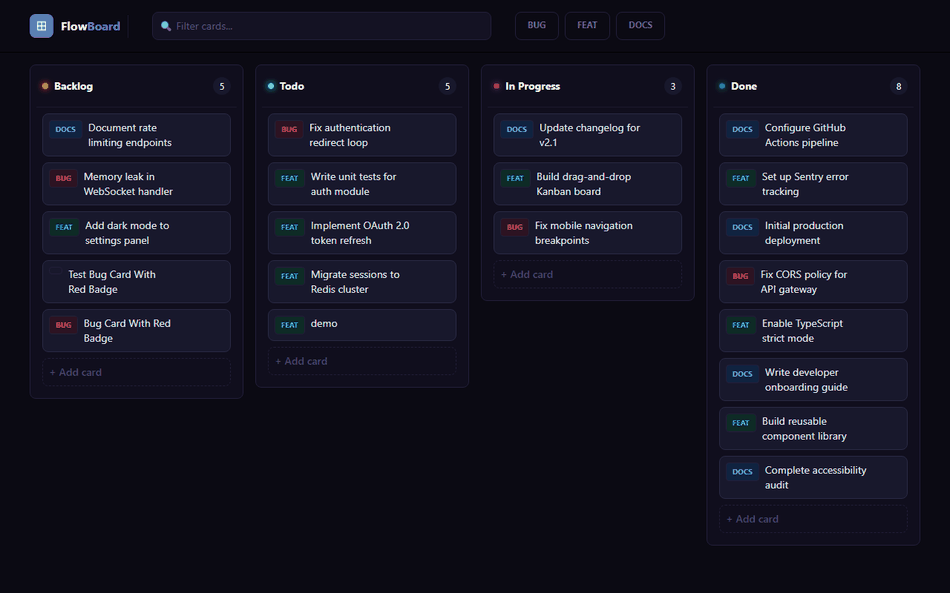

# 📋 FlowBoard — Kanban Board with Drag & Drop

[](https://react.dev/)
[](https://www.typescriptlang.org/)
[](https://tanstack.com/query/latest)
[](https://expressjs.com/)
[](https://orm.drizzle.team/)
[](https://www.postgresql.org/)
[](https://tailwindcss.com/)
[](https://reactrouter.com/)
[](https://vitejs.dev/)

FlowBoard is a modern, accessible, high-performance Kanban board built with **React 19**, **TypeScript**, **Express.js**, **Drizzle ORM + PostgreSQL**, **dnd-kit**, and **TanStack Query v5**. It supports smooth drag-and-drop card reordering within and across columns, URL-based state filtering, full card CRUD operations, optimistic UI updates with automatic rollback on network failure, and full keyboard accessibility.

🚀 **Ready for Portfolio / CV Showcase**

🔗 **Live Demo:** [flowboard-pearl-two.vercel.app](https://flowboard-pearl-two.vercel.app/)



---

## ✨ Features

- 🖱️ **Accessible Drag-and-Drop**: Built using `@dnd-kit/core` and `@dnd-kit/sortable` supporting both **mouse** and **keyboard** navigation.
- ⚡ **Optimistic Updates & Instant Rollback**: Reordering cards immediately reflects in the UI. If the server update fails (e.g. backend offline), TanStack Query instantly rolls back state without duplicating or losing cards.
- 📝 **Card Management (CRUD)**: Create new cards, edit existing titles and color-coded labels, and delete cards with instant UI updates via server actions.
- 🗄️ **Relational PostgreSQL Storage**: Columns and cards are persisted in a PostgreSQL database managed via **Drizzle ORM** with cascade constraints.
- 🌐 **Express.js REST API Backend**: Node.js Express API handling RESTful routes (`/api/columns`, `/api/cards`) with CORS support and environment configuration.
- 🔍 **URL-Driven Search & Filtering**: Text (`title`) and tag (`label`) filters sync dynamically with URL parameters (`useSearchParams`). Shared URLs retain exact search states across refreshes and browser history navigation.
- 🧮 **Derived State Architecture**: Card positions and column distributions are calculated on-the-fly during render. Eliminates state drift bugs caused by duplicated per-column React state.
- 🎨 **Sleek UI & Polish**: Modern dark UI built with Tailwind CSS v4, custom loading skeletons (`BoardSkeleton.tsx`), empty state indicators, and responsive horizontal column scrolling.

---

## 🛠️ Tech Stack

- **Frontend Framework**: React 19 + Vite 8 + TypeScript 6
- **Backend API**: Express 5 + Node.js (`api/server.ts`, `api/index.ts`)
- **Database & ORM**: Drizzle ORM + PostgreSQL (`pg`, `drizzle-kit`)
- **Drag & Drop**: `@dnd-kit/core`, `@dnd-kit/sortable`, `@dnd-kit/utilities`
- **State Management & Server Cache**: `@tanstack/react-query` v5 & DevTools
- **Routing & URL State**: `react-router-dom` v7
- **HTTP Client**: `axios`
- **Styling**: Tailwind CSS v4 & Lucide Icons

---

## 📂 Architecture & Directory Highlights

```text
flowboard/
├── api/                          # Express backend API server
│   ├── config/
│   │   └── env.ts                # Environment variable configuration
│   ├── routes/
│   │   ├── cardRoutes.ts         # Card CRUD REST endpoints (/api/cards)
│   │   └── columnRoutes.ts       # Column REST endpoints (/api/columns)
│   ├── index.ts                  # Express app setup & middleware
│   └── server.ts                 # Backend server entrypoint (pnpm run server)
├── drizzle/                      # Database migrations
├── docs/                         # Showcase assets (demo.gif, demo.webp)
├── src/
│   ├── api/
│   │   └── axios.ts              # Frontend Axios HTTP client setup
│   ├── components/
│   │   ├── board/
│   │   │   ├── AddAndEditCard.tsx    # Card trigger & dialog wrapper
│   │   │   ├── Board.tsx             # Main Kanban board container & dnd-kit context
│   │   │   ├── BoardSkeleton.tsx     # Skeleton loading state
│   │   │   ├── CardComponent.tsx     # Draggable card item
│   │   │   └── ColumnComponent.tsx   # Droppable column container
│   │   ├── forms/
│   │   │   └── AddAndEditCardForm.tsx # Card creation & editing modal form
│   │   └── ui/
│   │       ├── EditAndDeleteBtn.tsx  # Card action dropdown buttons
│   │       ├── Header.tsx            # Header search & filter toolbar
│   │       └── Logo.tsx              # Brand logo
│   ├── db/
│   │   ├── index.ts              # Drizzle ORM PostgreSQL connection pool
│   │   └── schema.ts             # Drizzle tables & relations schema (columns, cards)
│   ├── hooks/
│   │   └── useBoardQueries.ts    # TanStack Query custom hooks & optimistic updates
│   ├── types/
│   │   └── index.ts              # TypeScript interface definitions
│   ├── App.tsx                   # Main layout wrapper
│   ├── Router.tsx                # React Router v7 setup
│   └── main.tsx                  # Root mount point & QueryClientProvider
├── .env                          # Environment variables
├── drizzle.config.ts             # Drizzle Kit configuration
├── package.json                  # Dependencies & scripts (`dev`, `server`, `build`)
├── tsconfig.json                 # TypeScript compiler setup
└── vite.config.js                # Vite build configuration
```

---

## 🚀 Quick Start & Setup

### Prerequisites
- Node.js (v18+ recommended)
- `pnpm` (or `npm` / `yarn`)
- PostgreSQL database instance

### 1. Clone & Install Dependencies
```bash
git clone https://github.com/FaizaTasneeem/flowboard.git
cd flowboard
pnpm install
```

### 2. Configure Environment Variables
Create a `.env` file in the root directory:
```env
# Backend Server & Database
PORT=5000
FRONTEND_ORIGIN=http://localhost:5173
DATABASE_URL=your_postgresql_connection_string

# Frontend Configuration
VITE_BACKEND_SERVER=http://localhost:5000/api
```

### 3. Start Backend API Server
Launch the Express REST API server:
```bash
pnpm run server
```

### 4. Start Frontend Development Server
In a separate terminal window, launch the Vite dev server:
```bash
pnpm run dev
```
Open [http://localhost:5173](http://localhost:5173) in your browser.

---

## 🧠 Architecture & Key Technical Decisions

### 1. Derived State over Duplicated State
Rather than copying server cards into separate per-column React state objects (`useState`), FlowBoard maintains a single source of truth fetched via TanStack Query (`cards`). Each column computes its card list dynamically during render by filtering `cardData`. This prevents out-of-sync state bugs between column containers and card arrays.

### 2. Immutable Reorder Logic
When dragging cards within or across columns, array transformations are performed using dnd-kit's `arrayMove` helper and pure mapping (`.map()`). Existing state objects are never mutated directly in place, ensuring React accurately detects state diffs and re-renders components efficiently.

### 3. PostgreSQL Relational Persistence & Drizzle ORM
Board columns and cards are stored in a PostgreSQL database using Drizzle ORM. Card records reference their parent column ID via foreign keys with cascade deletion (`onDelete: 'cascade'`).

### 4. URL Param Persistence
Filters live in the URL search params (`?title=auth&label=bug`). The search inputs read directly from URL query parameters. This allows board states to be bookmarked and shared seamlessly.

---

## 💡 What Was Hard & How I Solved It

### 1. Cross-Column Index Calculation & Reorder Math
**The Challenge**: Moving a card from one column to another using `dnd-kit` requires updating both the target card's `columnId` and recomputing global list order indexes (`order`) across all affected cards without creating duplicate or missing index numbers. Dropping a card onto an empty column vs. dropping it between existing cards required different index offset formulas.

**The Solution**: I designed a deterministic two-step calculation in `handleDragEnd`. First, `updateActiveCardCol` assigns the target `columnId` immutably to the dragged card. Second, if dropping onto an empty column target (`overCardPos === -1`), the position resolves to the last index of that target column (`getOverColumnLastIdx`). Finally, `arrayMove` reorders the array, and a pure `.map()` re-indexes every card with a sequential `order` property before mutating the server cache.

### 2. Optimistic UI Updates with Reliable Cache Rollback
**The Challenge**: Users expect drag-and-drop actions to respond instantly without waiting for network round-trips. However, if the server request fails, the UI must gracefully revert without losing data integrity or creating ghost cards.

**The Solution**: Using TanStack React Query's `useMutation`, I implemented an optimistic update strategy in `useUpdateCardList`:
- **`onMutate`**: Immediately cancels outgoing queries for `['cards']`, snapshots the previous cache state via `queryClient.getQueryData(['cards'])`, and writes the newly computed order directly to the query cache using `queryClient.setQueryData`.
- **`onError`**: Restores the pre-drag snapshot if the mutation throws an error.
- **`onSettled`**: Invalidates `['cards']` to sync with the server once operations complete.
To test rollback resilience, stop the backend server while dragging — the card animates smoothly to its target position and immediately snaps back to its original position upon backend rejection.

### 3. Accessible Keyboard Navigation
**The Challenge**: Standard visual drag-and-drop often excludes keyboard users.

**The Solution**: Integrated dnd-kit's `KeyboardSensor` with `sortableKeyboardCoordinates`. Users can tab to any card, press `Space`/`Enter` to lift it, navigate using Arrow keys to shift positions or columns, and press `Space`/`Enter` again to drop.

---

## 🧪 Verification & Testing

- **Rollback Test**: Stop the backend Express server (`npm run server`) while dragging a card. The card will optimistically move and instantly snap back to its original position upon failed mutation.
- **Keyboard Test**: Tab to a card, press `Space` to pick up, use `Arrow Keys` to reorder within/across columns, press `Space` to drop.
- **Filter Persistence Test**: Enter search text or select a label tag. Copy the URL, open in a new tab, and verify that the filter inputs and board cards match the query state.

---

## 📜 License
MIT License © [Faiza Tasneem](https://github.com/FaizaTasneeem)
